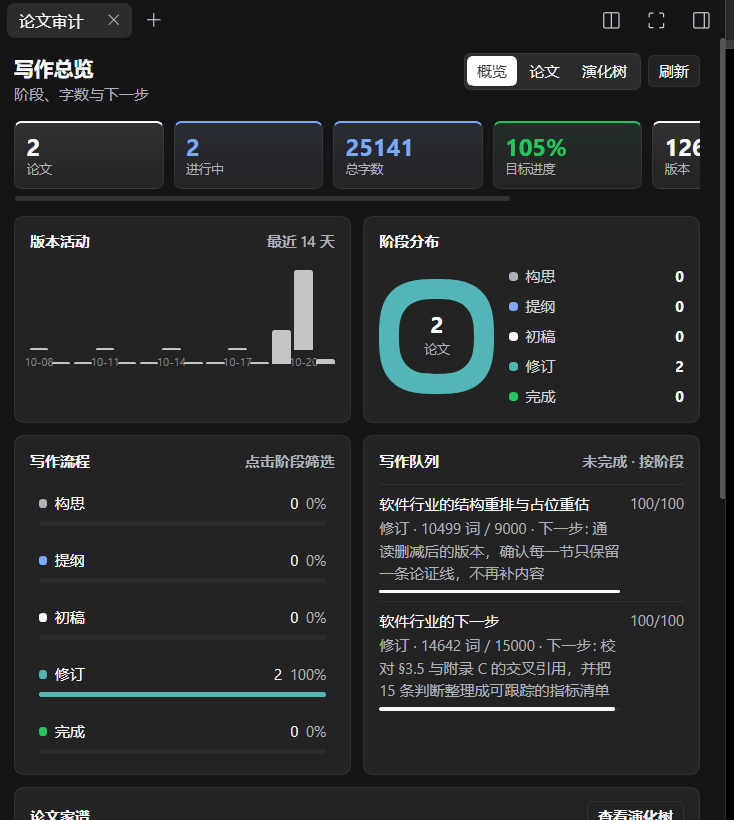
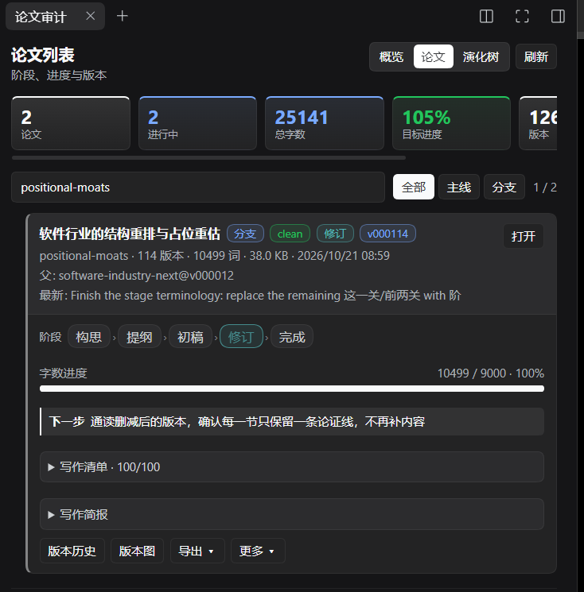
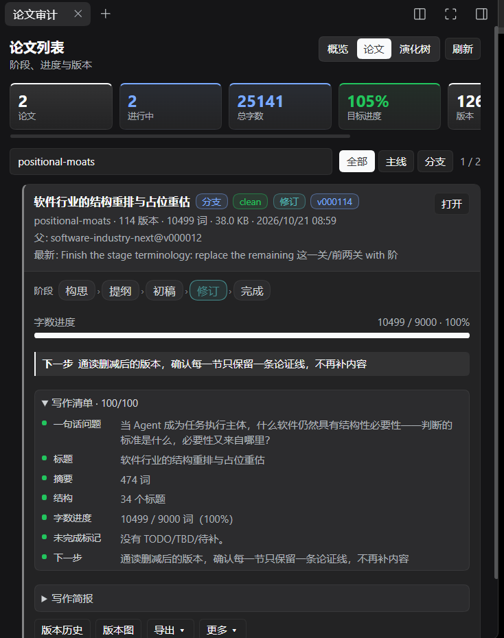
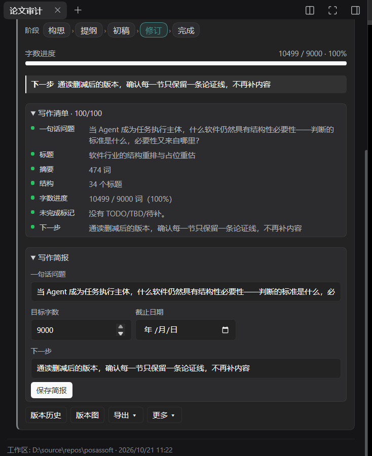
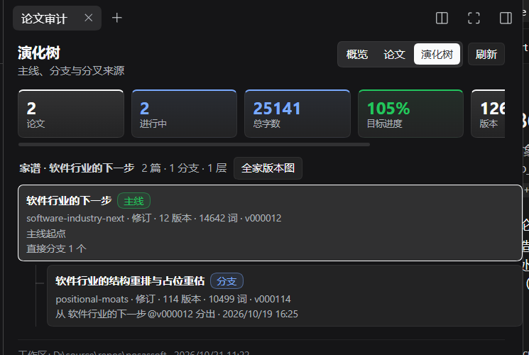
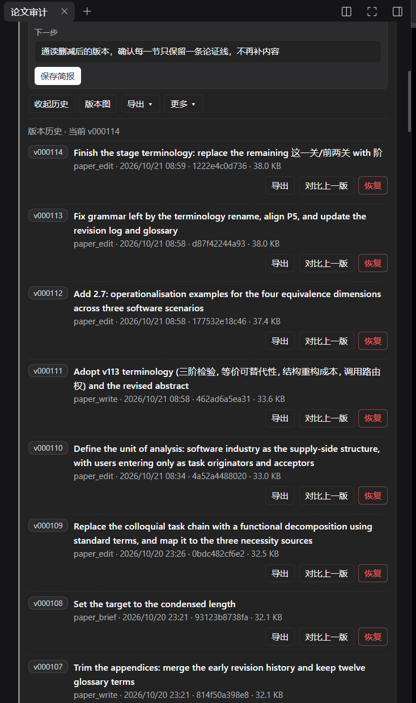
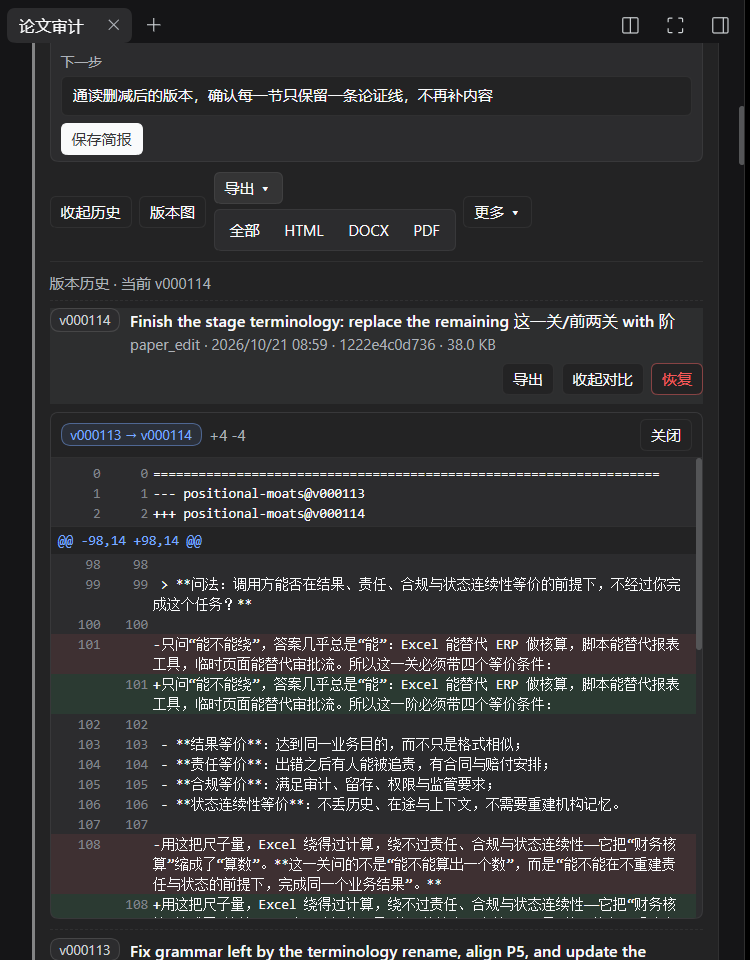
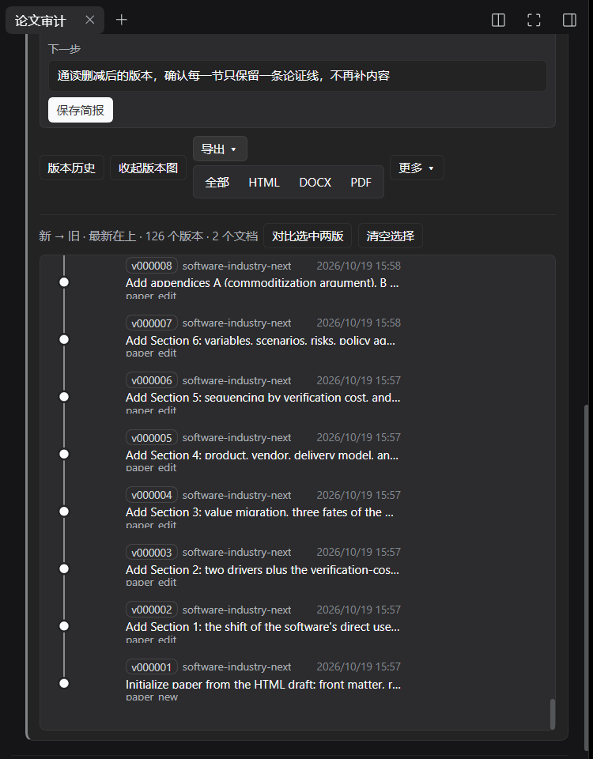
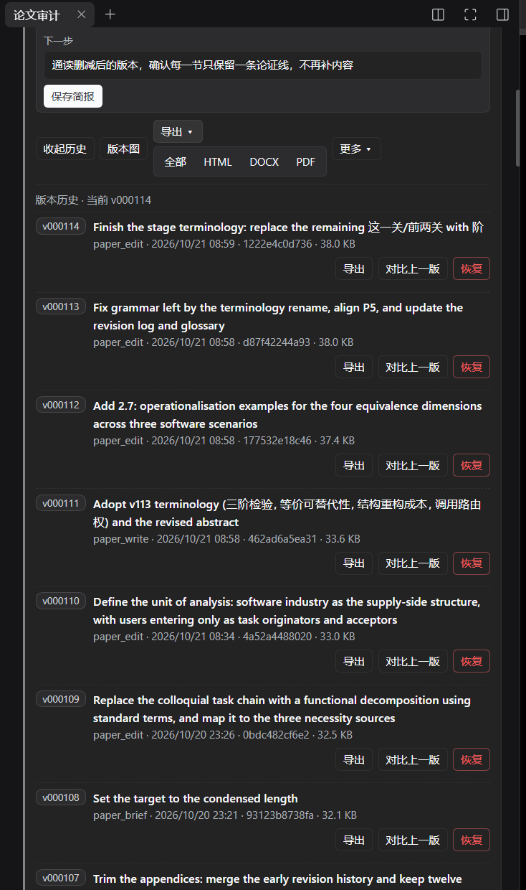

# dsh-paper

DeepSeek Harness 的论文写作插件：**Markdown 单一真源 + 强制版本管理 + 主题分叉 + HTML/DOCX/PDF 发布**。

> 当前为 v0.1.0（含右侧栏审计面板）。它已经作为组合包（bundle）安装到本机的 `desktop` profile；修改 host 代码或客户端入口后需要重启 DSH，并刷新 Web 页面，才会加载最新的工具 schema 与右栏插件。

## 为什么需要它

论文的演进过程本身就是资产：哪一版改了什么、为什么改、什么时候分叉出新的主题，都需要可追溯。dsh-paper 把这件事变成默认行为：

- 论文只写 Markdown：`papers/<docId>/<docId>.md`。
- 每次写入自动生成不可变版本，历史只追加，不覆盖。
- 发布产物与具体版本绑定，同一版本可重复导出。
- 一篇论文可以按章节分叉成多篇独立论文，并记录血缘。

## 界面截图

截图已收录在 [`docs/screenshots/`](docs/screenshots/)，展示右栏“论文审计”面板的主要使用路径。

### 写作总览与论文管理

| 写作总览 | 论文列表 |
|---|---|
| [](docs/screenshots/02-overview.png) | [](docs/screenshots/03-paper-list.png) |
| **写作总览**：关键指标、版本活动、阶段分布、写作流程与写作队列。 | **论文列表**：阶段步进器、字数进度、下一步、写作清单与版本操作。 |
| **写作清单** | **写作简报** |
| [](docs/screenshots/04-checklist.png) | [](docs/screenshots/05-brief.png) |
| **写作清单**：问题、标题、摘要、结构、字数、TODO 与下一步的逐项检查。 | **写作简报**：一句话问题、目标字数、截止日期与下一步可直接编辑。 |

### 版本、分叉与对比

| 演化树 | 版本历史 |
|---|---|
| [](docs/screenshots/06-lineage.png) | [](docs/screenshots/07-version-history.png) |
| **演化树**：主线、分支、子分支及分叉来源版本。 | **版本历史**：message、source、hash、时间与导出/对比/恢复操作。 |
| **版本 diff** | **版本图** |
| [](docs/screenshots/08-diff-previous.png) | [](docs/screenshots/09-version-graph.png) |
| **版本 diff**：在版本行下方内联展开，带新旧行号与 +/- 统计。 | **版本图**：新版本在上、初始版本在下；lane 区分论文与分支。 |

### 导出

[](docs/screenshots/07-export-menu.png)

导出全部、HTML、DOCX、PDF 收进折叠菜单，历史版本也可单独导出。

## 快速开始

在 DSH 会话里直接对 agent 说：

- “新建一篇论文，题目是《…》，先列提纲。”
- “把第 2 节的方法部分改写，版本说明写 `Clarify retrieval setup`。”
- “把这篇论文的第 2、3 节分叉成两篇独立论文。”
- “导出最新版本为 HTML、Word 和 PDF。”

也可以使用人类命令：

~~~text
/paper                 列出论文与当前版本
/paper history <doc>   查看版本历史
/paper check <doc>     写作阶段、字数与清单
/paper export <doc>    导出最新版本（默认三种格式）
~~~

## 目录结构

~~~text
papers/
  .paper/                         # 版本库（权威历史，不要手工改）
    registry.json                 # 论文索引
    versions/
      <docId>/
        history.json              # 版本元数据，追加式
        v000001.md                # 该版本的完整 Markdown 快照
        v000001.json              # 版本 sidecar（hash、message、来源）
  <docId>/
    <docId>.md                      # 当前工作副本，人可读
    figures/                      # 图片等资源（按相对路径引用）
exports/
  <docId>/
    v000001/
      <docId>-v000001.html
      <docId>-v000001.docx
      <docId>-v000001.pdf
      manifest.json               # 版本 hash、生成时间、产物清单
~~~

- `<docId>.md` 是**当前工作副本**；`.paper/versions/*.md` 是**不可变历史**。
- 版本文件带完整 front matter，所以任何一个版本都可以独立恢复、比较、导出。
- 备份或迁移论文时，请连同 `papers/.paper` 一起复制；它是历史真源。

## 版本模型

每个版本记录：

| 字段 | 含义 |
|---|---|
| `version` | 自增整数，从 1 开始 |
| `id` | `v000001` 形式 |
| `message` | 必填的变更说明 |
| `source` | `paper_new` / `paper_write` / `paper_edit` / `paper_branch` / `paper_restore` / `paper_status` / `paper_stage` / `paper_brief` / `external` |
| `sha256` | 该版本内容的 SHA-256 |
| `previous` | 上一个版本号 |
| `parents` | 分叉血缘 |
| `derivedFrom` | 从哪篇论文的哪个版本分化而来 |

规则：

1. 内容没有变化时**不创建**新版本（只差 `updatedAt` 也算无变化）。
2. 所有写入都必须带非空 `message`。
3. 恢复旧版本用 `paper_restore`，它会生成一个**新版本**，旧版本仍然保留。
4. 如果 `<docId>.md` 被外部编辑器或 shell 改过，`paper_list` 会显示 `DRIFT`；下一次 `paper_read` / `paper_write` / `paper_export` 会先把外部内容采纳为一个 `external` 版本。
5. 同一工作区的版本写入在进程内串行化；不要用多个 DSH 进程同时写同一套 `papers/`。

## 强制版本管理

插件在 `tools/pre-execute` 之后注册了一个单调守卫：

- 拒绝 `write` / `edit` / `str_replace_editor` 直接修改 `papers/**/<docId>.md`；
- 拒绝直接修改 `papers/.paper/**`；
- 提示改用 `paper_write` / `paper_edit`。

这不是唯一防线：外部改动仍可能绕过守卫，但会被下次 paper 操作自动采纳，不会丢内容。把 `allowDirectWrites` 设为 `true` 可以关闭守卫（不建议）。

## 模型工具

| 工具 | 作用 |
|---|---|
| `paper_new` | 新建论文，写入 v000001；可只给 `content`，标题从 H1 推导；可带 `stage/targetWords/question/nextAction` |
| `paper_list` | 列出论文、当前版本、阶段、字数/目标、清单分、DRIFT、版本数、血缘 |
| `paper_brief` | 更新写作简报（阶段、问题、目标字数、下一步、截止日期），生成 `paper_brief` 版本 |
| `paper_check` | “先写出来”写作清单：问题、标题、摘要、结构、字数、TODO、下一步 |
| `paper_read` | 读当前/历史版本或单节；`brief:true` 只回元数据+目录 |
| `paper_write` | 整体替换正文，生成新版本 |
| `paper_edit` | 精确替换一段或多段文字，生成新版本 |
| `paper_history` | 版本历史（id、时间、message、source、hash） |
| `paper_diff` | 两个版本正文的 unified diff；`includeFrontMatter:true` 时包含元数据 |
| `paper_restore` | 把旧版本恢复为新版本 |
| `paper_branch` | 从一个论文/版本分化出 1..N 篇独立论文 |
| `paper_export` | 导出 HTML/DOCX/PDF，产物绑定版本；`watch:true` 可监听 DOCX 并自动回写 |
| `paper_import_docx` | 把编辑过的 Word 转回 Markdown，预览 diff 后写成 `docx_import` 新版本 |

### 写入示例

~~~json
{
  "docId": "rag-survey",
  "replacements": [
    { "oldText": "我们使用单一检索器。", "newText": "我们使用稠密检索与 BM25 混合检索。" }
  ],
  "message": "Revise Section 3.1: describe the hybrid retriever"
}
~~~

### 分叉示例

~~~json
{
  "from": "rag-survey",
  "fromVersion": "3",
  "branches": [
    {
      "title": "Retrieval-Augmented Generation: A Focused Review",
      "slug": "rag-review",
      "sections": ["2 Methods", "3.1 Retrieval"]
    },
    {
      "title": "Evaluation Protocols for RAG",
      "slug": "rag-evaluation",
      "sections": ["4 Evaluation"]
    }
  ],
  "message": "Split the survey into two focused papers"
}
~~~

- `mode:"excerpt"`（提供 `sections` 时的默认值）：保留 H1、摘要区和选中的章节（含子章节）。
- `mode:"full"`：整篇复制后另起标题。
- 摘要区默认自动包含；每个分支可用 `includeAbstract:false` 关闭。
- 章节选择器支持编号（`2.1`）或标题文本（`Methods`）。歧义或找不到会报错并列出可选章节。
- 每个分支从 v000001 开始；父论文的 `lineage.children` 和新论文的 `lineage.parents` 都会记录。
- 分叉时会复制源论文目录下的图片/附件，分支因此可以独立导出。

## 导出

`paper_export` 从**某个不可变版本**渲染，默认三种格式：

| 格式 | 实现 | 说明 |
|---|---|---|
| HTML | `marked` + 内置学术样式 | 独立文件，含标题页、目录、表格、图片（内嵌 data URI） |
| DOCX | `docx` | 标题页、静态目录、标题层级、列表、表格、图片、页眉页脚页码 |
| PDF | 本机 Chrome/Edge headless `--print-to-pdf` | A4、打印样式、目录页与正文分页 |

- 产物目录：`exports/<docId>/<versionId>/`，文件名为 `<docId>-<versionId>.html|.docx|.pdf`；同一版本重复导出会覆盖同目录产物，不改变源版本。
- `manifest.json` 记录源版本 hash、生成时间、每个产物的成功/失败。
- PDF 找不到浏览器时，HTML 与 DOCX 仍会成功，PDF 会在 `files` 里报告失败原因，不会让整个导出失败。
- 图片按 Markdown 相对路径读取；HTML/PDF 会内嵌，DOCX 会嵌入原图。

### 在 Word 里修改（回写）

Markdown 仍是唯一真源，DOCX 是派生产物。需要拿 Word 改内容时，不要让 Word 文件变成第二个源，而是把它当作一次“回写”：

1. 导出目标版本的 DOCX：
   ```json
   { "docId": "rag-survey", "formats": ["docx"] }
   ```
2. 在 Word 里编辑并保存；文件名里的 `v000123` 会作为 `baseVersion`。
3. 先预览，不写版本：
   ```json
   { "docId": "rag-survey", "path": "D:/papers/rag-survey-v000123.docx", "confirm": false }
   ```
4. 检查返回的 `patch`、`warnings`、`images` 后确认：
   ```json
   { "docId": "rag-survey", "path": "D:/papers/rag-survey-v000123.docx", "confirm": true, "message": "Import Word edits: tighten Section 3" }
   ```
5. 导入会生成 `source:"docx_import"` 的新版本；原 DOCX 保留为外部副本，历史仍只追加。

如果论文在导出后又前进过，预览会标记 `conflict`，确认会被拒绝；重新导出最新版再改，或审阅 diff 后用 `force:true`。

#### 自动回写（watch）

如果不想每次手动导入，可以让插件监听导出的 DOCX：

```json
{ "docId": "rag-survey", "formats": ["docx"], "watch": true }
```

- 返回的 `watch` 对象包含 `id`、`filePath`、`status`、`lastVersion`。
- 在 Word 里编辑并保存后，文件稳定约 1.5 秒，插件自动转换并提交一个 `source:"docx_import"` 新版本。
- 每次保存只提交一次；内容没变不会产生空版本。
- 如果论文在 DOCX 打开期间又前进了，watch 会停在 `conflict`，不会覆盖新内容；重新导出并重新 watch 即可。
- 自动回写不会反过来重写 DOCX，因此不会形成导出/导入循环。

注意：`exports/<docId>/<versionId>/` 是发布产物，直接改它会破坏 manifest 的版本绑定。建议把 DOCX 复制到 `papers/<docId>/work/` 后再编辑，或只把发布产物当只读快照。

限制：Word 批注、修订痕迹、复杂公式、文本框、页眉页脚不会完整转换；自动回写前仍建议在版本历史里看 diff。图片会复制到 `papers/<docId>/assets/`。大批量格式调整仍建议在 Markdown/HTML 层完成，Word 只做文字修订。

### 配置 PDF 浏览器

默认查找 Chrome/Edge。也可以显式指定：

~~~yaml
- id: dsh-paper
  name: '@local/dsh-paper'
  config:
    export:
      pdf:
        browserPath: 'C:/Program Files/Google/Chrome/Application/chrome.exe'
        timeoutMs: 120000
~~~

或设置环境变量 `PAPER_BROWSER`。

## 安装与配置

本机已经安装到 `desktop` profile。给其他 profile 安装：

~~~powershell
dsh plugin --profile <name> add D:/source/repos/paperharness
~~~

重启 DSH 后生效。插件包名是 `@local/dsh-paper`，通过 `link:` 指向本目录。

完整配置项（写在 `cordis.patch.yml` 的插件行里）：

| 字段 | 默认值 | 含义 |
|---|---|---|
| `papersDir` | `papers` | 论文根目录（相对工作区） |
| `exportsDir` | `exports` | 发布产物根目录（相对工作区） |
| `allowDirectWrites` | `false` | 是否允许绕过 paper_* 工具直写 |
| `autoAdoptExternal` | `true` | 外部改动是否自动采纳为新版本 |
| `maxPaperBytes` | 4 MiB | 单篇 Markdown 大小上限 |
| `maxDiffChars` | 120000 | diff 输出截断长度 |
| `startTurnCooldownMs` | 5000 | 面板“让 Agent 审阅”的重复提交冷却 |
| `export.html.toc` | `true` | HTML 是否生成目录 |
| `export.html.numberSections` | `true` | 标题未编号时是否用 CSS 自动编号 |
| `export.docx.toc` | `true` | DOCX 是否生成静态目录 |
| `export.docx.bodyFont` | `SimSun` | DOCX 正文字体 |
| `export.docx.headingFont` | `Microsoft YaHei` | DOCX 标题字体 |
| `export.docx.codeFont` | `Consolas` | DOCX 代码字体 |
| `export.pdf.browserPath` | `null` | Chrome/Edge 可执行文件路径 |
| `export.pdf.timeoutMs` | 120000 | PDF 转换超时 |


## 右侧栏审计面板

插件包含一个 Web 客户端半边，在会话右侧栏注册 **“论文审计”页面**。

打开方式：

1. 打开会话右侧栏；
2. 在引导页/“添加”入口点击 **论文审计**（或直接在右侧栏的引导页卡片中打开）。

面板分为 **概览**、**论文** 与 **演化树** 三个视图。

### 概览

- **KPI**：论文、进行中、总字数、目标进度、版本、分支；
- **版本活动图**：最近 14 天的版本提交柱状图，快速看出写作节奏；
- **阶段分布**：构思 / 提纲 / 初稿 / 修订 / 完成 的环形图与图例；
- **写作流程**：构思 → 提纲 → 初稿 → 修订 → 完成 的进度条，点击阶段直接筛出对应论文；
- **最近活动**：跨论文的最新版本提交，点击定位到对应论文卡片；
- **写作队列**：未完成论文按阶段列出，带字数、进度、下一步和截止日期，点击定位；
- **论文家谱**：按主线/分支汇总每个家族，点击进入演化树。

### 论文

- **阶段步进器**：每张卡片上有 构思 → 提纲 → 初稿 → 修订 → 完成，点击即推进阶段并生成一个新版本；
- **字数进度**：显示当前字数 / `targetWords` 和进度条；“下一步”直接显示 `nextAction`，截止日期可见；
- **写作清单**：`paper_check` 的 7 项建议（问题、标题、摘要、结构、字数、TODO、下一步），可折叠查看；
- **写作简报**：卡片内可直接编辑问题、目标字数、下一步、截止日期，保存生成 `paper_brief` 版本；
- **论文家族**：分支按血缘分组，带“分支”标记、父论文定位、独立审计/导出/恢复/继续分叉；
- **版本历史**：message/source/hash/时间，支持对比上一版、恢复、按版本导出；“对比上一版”在**当前版本行下方内联展开**，带加载态、版本范围、+/- 统计、行号和可滚动 diff；再点一次收起；
- **版本图**：类似 git 的 lane 图，节点是版本，实线连接上一版，虚线连接主题分支；**新版本在上、初始版本在下**，点击任意两个节点即可跨论文/跨分支对比，默认自动选中当前论文最近两个版本；
- **渐进式操作**：主操作只保留“打开 / 版本历史 / 版本图”，导出格式与分叉/审阅等收进“导出 / 更多”折叠菜单，避免一排等权按钮；
- **筛选**：全部 / 主线 / 分支，加上写作阶段筛选与搜索，可组合。

### 演化树

- **主线**：家族根节点标为“主线”，显示阶段、版本数、字数、当前版本。
- **分支层级**：一级分支、子分支按树状缩进嵌套，能看出“分支再分支”的多轮演化。
- **分叉来源**：每条分支边显示「从 <parent>@<version> 分出 · 时间」，明确它从主线的哪一版、哪一刻分出来。
- **点击定位**：点任意节点回到“论文”视图并定位该论文，再打开版本历史/版本图。
- **全家版本图**：家族标题旁的按钮直接打开该家族的版本图，把论文级关系下钻到版本级分叉点。
- **异常提示**：父论文不在当前工作区时标为“孤立分支”并提示父论文缺失。
- **与版本图的区别**：演化树是**论文级**关系（主线/分支/子分支），版本图是**版本级**关系（同一论文的上一版、跨论文的分叉点）；两者配合，才知道“这篇论文从哪来、怎么变成现在这样”。

### Diff 交互

- **就地展开**：点击某个版本的“对比上一版”，diff 直接展开在该版本行下方，不再跑到卡片最底部。
- **即时反馈**：按钮立即变为“对比中…”，版本行高亮；请求失败时错误就显示在该行下方，不会静默。
- **可读性**：头部显示版本范围与 +/- 统计；正文是带新旧行号的 unified diff，增删行有独立底色，长 diff 在 360px 高度内滚动。
- **可收起**：再点一次“收起对比”或头部“关闭”即可回到历史列表。
- **任意两版**：历史列表的“对比上一版”用于相邻版本；跨版本/跨论文的任意 A/B 对比继续用版本图选中两个节点。
- **下一步**：历史列表可加 A/B 选择与并排视图；当前先保证“点哪一版，diff 就出现在哪一版下面”。

### 视觉风格

- 回到 **DSH 原生 token 配色**，不再叠加自定义深色/彩色主题。
- **配色按语义分组**：论文/版本用 brand，进行中/字数用 info，目标/分支用 success；修订用 info+success 混合，避免黄色主导。所有颜色都来自 DSH token，自动适配浅色/深色主题。
- **KPI 一排横向滚动**：六项指标保持一行；宽屏自动铺满，窄屏横向滚动，不再变成多行。
- **版本历史**：最新版本在上；对比上一版仍在当前版本行下方内联展开。
- **版本图**：新版本在上、初始版本在下；lane 用原有主题色区分。
- **演化树**：主线/分支按层级缩进，分支显示来源版本与时间。
- **diff**：保留行号、增删底色和 +/- 统计。

所有论文——主线与分支——共用同一套版本、审计、导出与恢复流程。面板通过同源的 `/paper/list`、`/paper/insights`、`/paper/check`、`/paper/history`、`/paper/diff`、`/paper/graph`、`/paper/compare`、`/paper/action` 访问宿主，不额外启动服务。写操作（导出、恢复、分叉、改阶段、改简报）要求当前会话的 cwd，避免把产物写进应用数据目录。

### 交互设计参考

这版面板的设计参考了以下成熟产品的交互模式：

- **Linear** — 上下文菜单与键盘优先，减少等权按钮；我们把导出/更多操作收进折叠菜单。[`linear.app/now/invisible-details`](https://linear.app/now/invisible-details)
- **GitKraken** — 提交图用 lane + 节点 + 详情面板表达历史；我们的版本图沿用 lane、实线/虚线边与行内详情。[GitKraken interface](https://help.gitkraken.com/gitkraken-desktop/interface/)
- **Notion / GitHub Projects** — 同一数据集提供多种视图（表格、看板、时间线），并用筛选/分组降低认知负担；我们提供概览/论文视图、流程阶段筛选与家族分组。[Notion views](https://www.notion.com/help/views-filters-and-sorts)、[GitHub layout docs](https://docs.github.com/en/issues/planning-and-tracking-with-projects/customizing-views-in-your-project/changing-the-layout-of-a-view)
- **Overleaf / Figma** — 版本历史、命名版本、对比与恢复放在同一处；我们的版本历史/版本图/恢复共享同一套版本模型。[Overleaf history](https://docs.overleaf.com/writing-and-editing/history-and-versioning)、[Figma version history](https://help.figma.com/hc/en-us/articles/360038006754-View-a-file-s-version-history)
- **Scrivener** — 以 binder/outliner 组织文稿结构；我们用论文家族与流程阶段表达结构。[Scrivener overview](https://www.literatureandlatte.com/scrivener/overview)
- **Nielsen Norman Group** — progressive disclosure：先给概览与主操作，细节按需展开；这是“概览优先 + 折叠菜单”的依据。[Progressive disclosure](https://www.nngroup.com/articles/progressive-disclosure/)

## 写作模式：先写出来

这一版把“先写出来，不追求投稿”作为默认管理目标，而不是用投稿合规压住初稿。

- **阶段**：构思 → 提纲 → 初稿 → 修订 → 完成，和发布 `status` 分开；阶段推进也会生成版本（`paper_stage`）。
- **字数目标**：`targetWords` + 当前字数，面板显示进度条；概览显示总字数与目标完成度。
- **下一步**：`nextAction` 是每次打开论文时唯一要记住的动作；卡片顶部直接显示。
- **写作清单**：`paper_check` / `/paper/check` 给出 7 项建议：问题、标题、摘要、结构、字数进度、TODO 标记、下一步；只提示，不阻止导出。
- **写作队列**：概览按阶段列出未完成论文，带字数、进度、下一步和截止日期。
- **简报编辑**：卡片里的“写作简报”可以直接改 `question` / `targetWords` / `nextAction` / `deadline`，保存后生成 `paper_brief` 版本。
- **工具**：`paper_brief` 更新简报/阶段；`paper_check` 查看清单；`paper_new` 可在创建时直接给 `stage`、`targetWords`、`question`、`nextAction`。

这个模式的完成标准不是“符合投稿要求”，而是：**有一个能从头读到尾的完整初稿，问题、结构、摘要和下一步都清楚，且所有改动可追溯。**

## 论文 Markdown 约定

~~~markdown
---
paper: my-paper
title: 论文标题
subtitle: 可选副标题
authors:
  - 张三
  - 李四
status: draft
stage: drafting
targetWords: 6000
question: 这篇论文要回答的一个问题是什么？
nextAction: 补完方法节的实验设置
deadline: 2026-11-30
keywords:
  - 关键词
language: zh-CN
createdAt: 2026-10-19T00:00:00.000Z
updatedAt: 2026-10-19T00:00:00.000Z
---

# 论文标题

## 摘要

……

## 1 引言

……

## 2 方法

### 2.1 实验设置


| 方法 | Recall@10 |
|---|---:|
| BM25 | 0.71 |
~~~

- 正文第一个标题是唯一 H1；章节用 H2/H3。
- 标题可以自带编号（`## 1 引言`），也可以不写编号（导出时 HTML/DOCX 自动编号）。
- 图片用相对路径；表格用 GFM 表格；公式暂按文本/代码块处理。
- `status` 是发布生命周期（draft/internal_review/submitted/under_review/published/archived）；`stage` 是写作阶段（idea/outline/drafting/revising/done），两者不要混用。
- `targetWords`、`question`、`nextAction`、`deadline` 用于“先写出来”模式的进度、清单和下一步；用 `paper_brief` 更新，不需要重写正文。

## 人与 agent 的入口

- **模型工具**：`paper_*`，由系统提示词和 `paper-writing` skill 引导。
- **人类命令**：`/paper`（list / status / history / export）。
- **系统提示词**：插件常驻一段 `paper:policy`，明确禁止绕过写守卫。
- **Skill**：`paper-writing`，包含完整工作流、失败处理与示例。

## 已知限制（基础版）

- 版本快照只包含 Markdown，不包含图片/附件的字节；导出历史版本时读取的是**当前**图片文件（分叉会复制一份资产）。后续会做按版本的资源快照。
- 不做 LaTeX/KaTeX 渲染、BibTeX 引用解析、交叉引用与自动编号图表。
- 分支是独立论文，暂不支持 merge/rebase 回主线。
- 守卫只覆盖内置文件工具；shell 直写不会被实时拦截，只能靠 `DRIFT` + 自动采纳兜底。
- 版本库写入是进程内串行锁；多进程同时写同一套 `papers/` 不安全。
- DOCX 目录是静态列表（无页码）；HTML/PDF 目录是链接。Word 中如需页码目录，可在 Word 里插入自动目录域。
- PDF 样式来自 HTML，和 DOCX 的排版不会逐像素一致。
- Word 回写只保证标题/段落/列表/基础表格/图片的基本转换；批注、修订痕迹、复杂公式、文本框、页眉页脚不会完整保留，导入前必须看 preview diff。

## 开发

~~~powershell
npm install
npm test
~~~

测试覆盖：

- `test/markdown.test.mjs`：front matter、章节解析、选择器、分叉内容。
- `test/store.test.mjs`：创建、无变化写入、编辑、diff、恢复、分叉血缘、版本图、跨论文对比、概览统计、状态流转、写作简报/阶段/清单、外部改动采纳。
- `test/export.test.mjs`：HTML/DOCX/PDF 产物、manifest、历史版本与分支论文导出（含资产复制/内嵌）。
- `test/import.test.mjs`：Word→Markdown 预览、确认、基础版本冲突与 force 回写。
- `test/watch.test.mjs`：DOCX 监听、保存后自动导入、冲突不覆盖。
- `test/integration.test.mjs`：插件注册、工具输出 schema、守卫、命令、skill、系统提示词、Word 导入工具。
- `test/web.test.mjs`：审计面板的同源 HTTP API（列表、概览、写作清单、历史、diff、版本图、跨论文对比、导出、恢复、分叉、阶段/简报/状态更新、startTurn、写路径校验）。
- `test/client.test.mjs`：右栏页面注册、初始渲染、版本图渲染、概览图表/流程渲染、论文家谱/演化树渲染、版本行内联 diff 渲染（React 模块加载契约）。

### 目录

~~~text
index.js              # 插件入口：注册工具/守卫/命令/skill/提示词
lib/store.js          # 版本库：registry、history、commit、branch、restore、export 快照
lib/markdown.js       # 章节树、选择器、分叉内容生成
lib/frontmatter.js    # YAML front matter
lib/draft.js          # 写作阶段与清单评分
lib/import/docx.js    # Word→Markdown 回写转换（mammoth + turndown）
lib/watch.js          # 监听 DOCX 保存，自动回写为 docx_import 版本
lib/tools.js          # paper_* 工具定义
lib/guard.js          # 直写守卫
lib/command.js        # /paper 命令
lib/skill.js          # paper-writing skill
lib/prompt.js         # 常驻策略段
lib/web.js            # 右侧栏审计面板的同源 HTTP API
lib/client.js         # 右侧栏“论文审计”页面（浏览器端）
lib/export/           # html / docx / pdf / 编排
test/                 # node:test 测试
~~~

## 后续完善方向

1. 每个版本快照图片/附件，保证历史版本导出完全可复现。
2. 分支 merge/rebase 与差异审阅。
3. LaTeX/KaTeX、BibTeX/CSL 引用、图表自动编号。
4. 更丰富的右栏 UI：分叉表单、批量发布、发布审批。
5. 跨进程文件锁与发布审批流。
6. 模板库（期刊/会议/学位论文）与投稿元数据。

## License

MIT